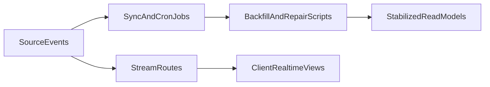

## Primary backend components

- Stream routes (leaderboard and locker-room stream endpoints)
- Non-admin cron/integration routes (for trend sync and similar tasks)
- Sync and backfill scripts under `scripts/` for data consistency
- Shared infra utilities (`logger`, retry/fetch helpers, env loaders)

## Core operational patterns

- Event stream delivery to clients with reconnect-aware client behavior
- Background synchronization for derived datasets
- Offline correction/backfill for historical inconsistencies

## Android App Links

Android verifies content URLs against [the statement on the content host](https://app.d-sports.org/.well-known/assetlinks.json). That host rewrites the well-known path to the API. [The API host](https://api.d-sports.org/.well-known/assetlinks.json) continues to serve the statement for mobile authentication and credential delegation. Both hosts must return JSON without a sign-in redirect.

The `com.dsports.engage` statement always includes the Play App Signing SHA-256 certificate fingerprint. For preview or upload builds, set the backend’s optional `ANDROID_ENGAGE_EXTRA_SHA256_FINGERPRINTS` to comma-separated, colon-delimited SHA-256 fingerprints for the certificates signing the installed APKs. The dynamic route deduplicates valid extras and skips malformed values; the legacy `com.dsports.wallet.beta` statement and iOS association file are unchanged.

Check the JSON on both hosts after deploying the setting. Static fallback files do not read the setting, and the dynamic response can be cached for up to an hour. On a device, use `adb shell pm get-app-links com.dsports.engage` to check verification.

## High-level flow

## Architectural notes

- Platform scripts are critical for migration-era and reconciliation tasks.
- Stream and sync systems are supportive layers for product features, not separate product domains.
- Operational runbooks should align with schema and API evolution.
