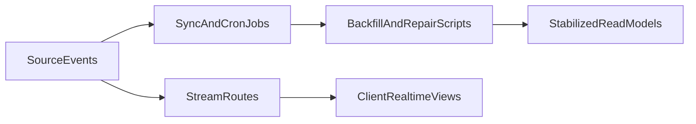

## Primary backend components

- Stream routes (leaderboard and locker-room stream endpoints)
- Non-admin cron/integration routes (for trend sync and similar tasks)
- Sync and backfill scripts under `scripts/` for data consistency
- Shared infra utilities (`logger`, retry/fetch helpers, env loaders)

## Core operational patterns

- Event stream delivery to clients with reconnect-aware client behavior
- Background synchronization for derived datasets
- Offline correction/backfill for historical inconsistencies

## Shared AI SDK foundation

The API uses Vercel AI SDK and AI Gateway for shared server-side text and schema-backed object generation. This infrastructure does not add routes or imply that writing, creator drafts, alt text, or assistant chat are available to clients.

Feature code applies an atomic per-fan quota before calling the model. The limiter uses Postgres, scopes the quota by feature and optionally by operation, and blocks the call if the quota cannot be checked. Feature code also uses prompt helpers to redact common PII and secrets, delimit untrusted input, and instruct the model to respond in the resolved locale (`en`, `fr-CH`, or `it-IT`). These safeguards are not built into the generation wrappers and do not guarantee output language.

Text and object generation default to a 12-second timeout and can propagate caller cancellation. A separate 30-second timeout constant is available for streaming integrations; this foundation does not provide a streaming endpoint or wrapper. Structured `ai.call` telemetry records the feature, model, locale, token counts when available, latency, outcome, and an optional error code. It excludes raw prompts, generated output, and credentials.

### AI runtime configuration

AI is off by default. To enable a feature that uses this foundation, set `AI_FEATURES_ENABLED` and the matching feature switch to `true`: `AI_WRITING_ENABLED`, `AI_CREATOR_DRAFTS_ENABLED`, `AI_ALT_TEXT_ENABLED`, or `AI_ASSISTANT_CHAT_ENABLED`. The check trims whitespace and ignores case; any value other than `true` leaves the switch off.

For example, to allow writing but keep alt text off, set the following on the server and leave the other feature switches unset. Writing still needs Gateway credentials.

```dotenv
AI_FEATURES_ENABLED=true
AI_WRITING_ENABLED=true
AI_ALT_TEXT_ENABLED=false
```

AI Gateway prefers a server-side `AI_GATEWAY_API_KEY` when configured. Otherwise the SDK uses Vercel OIDC, including `VERCEL_OIDC_TOKEN` or a request-scoped token in Vercel Functions. The preflight recognizes `VERCEL=1` or nonblank `VERCEL_ENV` as runtime OIDC indicators, not proof of valid credentials. Keep credentials out of clients. Missing credentials do not prevent API startup.

| Model tier | Optional server override | Default Gateway model |
| --- | --- | --- |
| Fast | `AI_MODEL_FAST` | `google/gemini-2.5-flash-lite` |
| Creator | `AI_MODEL_CREATOR` | `google/gemini-2.5-flash` |
| Vision | `AI_MODEL_VISION` | `google/gemini-2.5-flash` |

See [AI error codes](/api-reference/errors-and-status-codes#ai-error-codes) for disabled features and content blocks.

## Widget authentication and account data

The widget API accepts Clerk sessions and revocable, per-install credentials. The server stores only a token hash. A new token for a device replaces its previous token. This is a backend capability, not a claim that a particular native release uses widget credentials.

`POST /api/webhooks/clerk` verifies the Svix signature and revokes all of the affected user’s widget tokens for `session.revoked`, `user.deleted`, or `user.updated` with a password-update timestamp, locked account, or banned account. Other verified events succeed without revoking tokens.

Platform admins can list metadata with `GET /api/admin/users/{userId}/widget-tokens`. `DELETE` on that route revokes one `tokenId` (query or JSON body), or all active tokens if no ID is supplied, and records staff activity. Neither response exposes raw tokens or hashes.

A user’s GDPR data export includes sanitized `widgetTokens` metadata in `consents-and-sessions.json`, not raw tokens or hashes. Account deletion removes the token rows. See [widget snapshot behavior](/repositories/d-sports-api/platform-infra/behavior#widget-snapshot) for the read and cache contract.

## Android App Links

Android verifies content URLs against [the statement on the content host](https://app.d-sports.org/.well-known/assetlinks.json). That host rewrites the well-known path to the API. [The API host](https://api.d-sports.org/.well-known/assetlinks.json) continues to serve the statement for mobile authentication and credential delegation. Both hosts must return JSON without a sign-in redirect.

The `com.dsports.engage` statement always includes the Play App Signing SHA-256 certificate fingerprint. For preview or upload builds, set the backend’s optional `ANDROID_ENGAGE_EXTRA_SHA256_FINGERPRINTS` to comma-separated, colon-delimited SHA-256 fingerprints for the certificates signing the installed APKs. The dynamic route deduplicates valid extras and skips malformed values; the legacy `com.dsports.wallet.beta` statement and iOS association file are unchanged.

Check the JSON on both hosts after deploying the setting. Static fallback files do not read the setting, and the dynamic response can be cached for up to an hour. On a device, use `adb shell pm get-app-links com.dsports.engage` to check verification.

## High-level flow



## Architectural notes

- Platform scripts are critical for migration-era and reconciliation tasks.
- Stream and sync systems are supportive layers for product features, not separate product domains.
- Operational runbooks should align with schema and API evolution.
