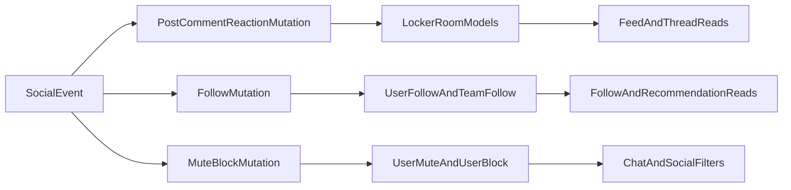

## Primary backend components

- `server/locker-room-actions.ts`
- `server/reaction-actions.ts`
- `server/team-follow-actions.ts`
- `app/api/locker-room/route.ts`
- `app/api/locker-room/[id]/comments/route.ts`
- `app/api/locker-room/[id]/react/route.ts`
- `app/api/locker-room/[id]/like/route.ts`
- `app/api/locker-room/posts/draft/route.ts`
- `app/api/user/follow/route.ts`
- `app/api/user/followers/route.ts`
- `app/api/user/mutes/route.ts`
- `app/api/user/blocks/route.ts`

## Core model touchpoints

- `LockerRoomPost`
- `LockerRoomPostMedia` stores optional screen-reader descriptions. `LockerRoomMediaUpload` records who uploaded media so the cloud fallback can restrict access to a fan's own upload.
- `LockerRoomPostComment`
- `LockerRoomPostReaction`
- `LockerRoomPostLike`
- `UserFollow`
- `TeamFollow`
- `UserMute`
- `UserBlock`

## High-level flow

## Architectural notes

- Social endpoints combine immediate write paths with read endpoints for feed composition.
- Stream endpoints support near-real-time update delivery patterns.
- Social and follow features are separate model families that intersect through user identity.
- `UserMute` and `UserBlock` are separate edges. Mute hides without notifying; block is the stronger exclusion used by native safety UI.
- `LockerRoomPost.teamId` is the about-tag. `LockerRoomPost.authorTeamId` is the post-as-team identity and is authorized separately.
- Lineup attachments persist on the post row and are echoed to clients. Composer drafts are a separate authenticated resource.

## Cloud alt-text configuration

The [cloud fallback](/api-reference/domains/social-locker-room#cloud-alt-text-fallback) has its own server-side Gateway client. `AI_ALT_TEXT_ENABLED` must be exactly `true`; setting `AI_FEATURES_ENABLED=false` overrides it. A nonblank `AI_GATEWAY_API_KEY` is required even on Vercel. This route does not use OIDC. `AI_MODEL_VISION` can override this route's default, `google/gemini-2.5-flash-lite`.

The fallback limits each authenticated fan to 20 requests per fixed one-hour window and times out the Gateway request after 12 seconds. It only accepts URLs on approved HTTPS media hosts with a recorded upload belonging to the caller. If an upload is not eligible or generation is unavailable, users can still supply their own description.
